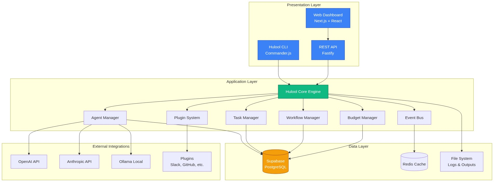

# 🤖 Hulool OS

**The Operating System for Zero-Human Companies**

[](https://github.com/hulool/hulool-os)
[](https://nodejs.org)
[](https://www.typescriptlang.org)
[](LICENSE)

---

## 🌟 نظرة عامة

**Hulool OS** هو منصة تنسيق وكلاء الذكاء الاصطناعي (AI Agent Orchestration Platform) تتيح لك بناء وإدارة "شركات بدون بشر" - حيث تقوم بتعيين فريق من الوكلاء الذكيين، وتحديد أهدافهم، ومراقبة أدائهم من لوحة تحكم واحدة.

### ✨ المميزات الرئيسية

- 🎯 **إدارة الوكلاء**: إنشاء، تعديل، ومراقبة وكلاء ذكاء اصطناعي متخصصين
- 💰 **حوكمة الميزانية**: تحكم كامل في تكاليف الـ API مع تنبيهات ذكية
- 🔄 **سير العمل**: أتمتة العمليات المعقدة عبر تنسيق عدة وكلاء
- 📊 **المراقبة المباشرة**: تتبع الأداء والتكاليف في الوقت الفعلي
- 🔌 **نظام الإضافات**: توسيع القدرات عبر إضافات مخصصة
- 🗄️ **Supabase Integration**: قاعدة بيانات سحابية قوية مع مصادقة مدمجة

---

## 🚀 البدء السريع

### المتطلبات

- Node.js 20+ 
- pnpm 8+
- حساب Supabase

### التثبيت

```bash
# تثبيت Hulool CLI عالمياً
npm install -g @hulool/cli

# إنشاء مشروع جديد
hulool init my-ai-company
cd my-ai-company

# إعداد المتغيرات البيئية
cp .env.example .env
# عدّل .env وأضف مفاتيح API

# إنشاء أول وكيل
hulool agent create

# بدء الخادم
hulool start
```

---

## 📚 التوثيق

| المستند | الوصف |
|---------|-------|
| [🏗️ Architecture](docs/ARCHITECTURE.md) | هيكل النظام والمعمارية |
| [🔄 Workflows](docs/WORKFLOWS.md) | سير العمل والتنسيق |
| [🗄️ Database](docs/DATABASE.md) | مخطط قاعدة البيانات |
| [⌨️ CLI Reference](docs/CLI.md) | دليل أوامر CLI الكامل |
| [🌐 API Reference](docs/API.md) | توثيق REST API |
| [👤 User Journey](docs/USER-JOURNEY.md) | رحلة المستخدم |
| [🤖 Agent Lifecycle](docs/AGENT-LIFECYCLE.md) | دورة حياة الوكيل |
| [🚀 Deployment](docs/DEPLOYMENT.md) | دليل النشر والإنتاج |

---

## 🎯 أمثلة الاستخدام

### إنشاء فريق محتوى

```bash
# إنشاء وكلاء الفريق
hulool agent create --name "Researcher" --role researcher --budget 200
hulool agent create --name "Writer" --role writer --budget 150
hulool agent create --name "Editor" --role reviewer --budget 100

# إنشاء هدف
hulool goal create \
  --name "Q1 Blog Series" \
  --agents researcher,writer,editor \
  --budget 500

# تشغيل سير العمل
hulool workflow run content-pipeline
```

### المراقبة المباشرة

```bash
# عرض حالة الوكلاء
hulool agent list

# مراقبة مباشرة
hulool monitor

# عرض الميزانية
hulool budget
```

---

## 🏗️ المعمارية



يعتمد Hulool OS على معمارية طبقات (Layered Architecture):

- **Presentation Layer**: CLI + Web Dashboard
- **Application Layer**: Core Engine + Agent Manager
- **Data Layer**: Supabase (PostgreSQL)
- **Integration Layer**: LLM Providers + Plugins

---

## 🤝 المساهمة

نرحب بالمساهمات! يرجى قراءة [دليل المساهمة](CONTRIBUTING.md) أولاً.

```bash
# استنساخ المستودع
git clone https://github.com/hulool/hulool-os.git
cd hulool-os

# تثبيت الاعتماديات
pnpm install

# تشغيل الاختبارات
pnpm test

# بناء المشروع
pnpm build
```

---

## 📄 الترخيص

MIT License - انظر ملف [LICENSE](LICENSE) للتفاصيل.

---

## 🌐 الروابط

- 🌍 **الموقع**: https://hulool.ai
- 📚 **التوثيق**: https://docs.hulool.ai
- 💬 **المجتمع**: https://discord.gg/hulool
- 🐦 **تويتر**: https://twitter.com/hulool_ai

---

<p align="center">
  Made with ❤️ by the Hulool Team
</p>
