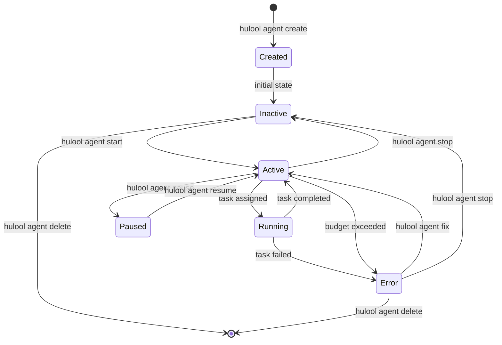
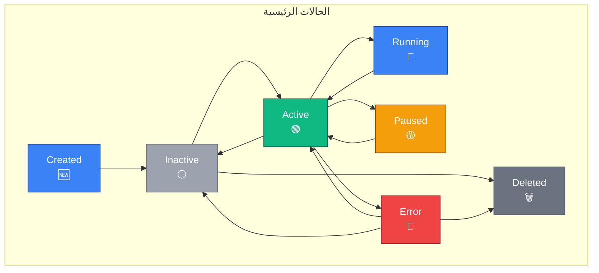
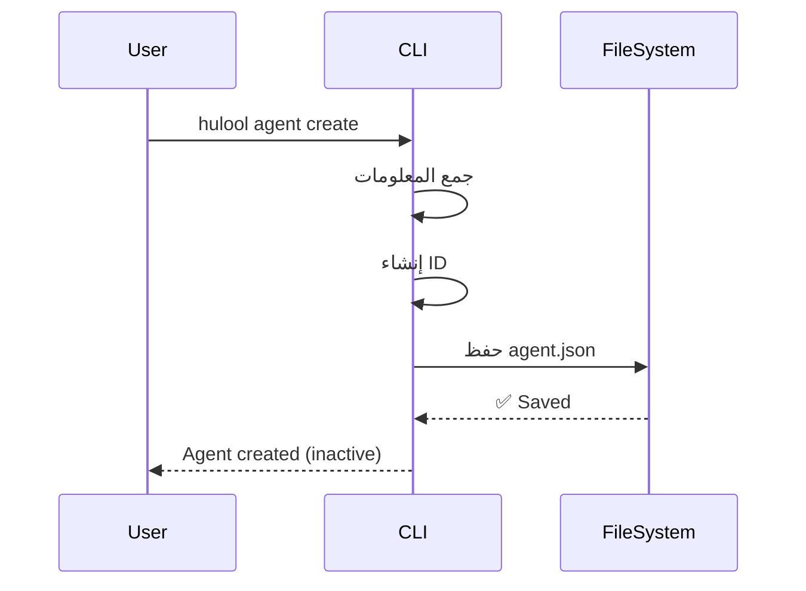
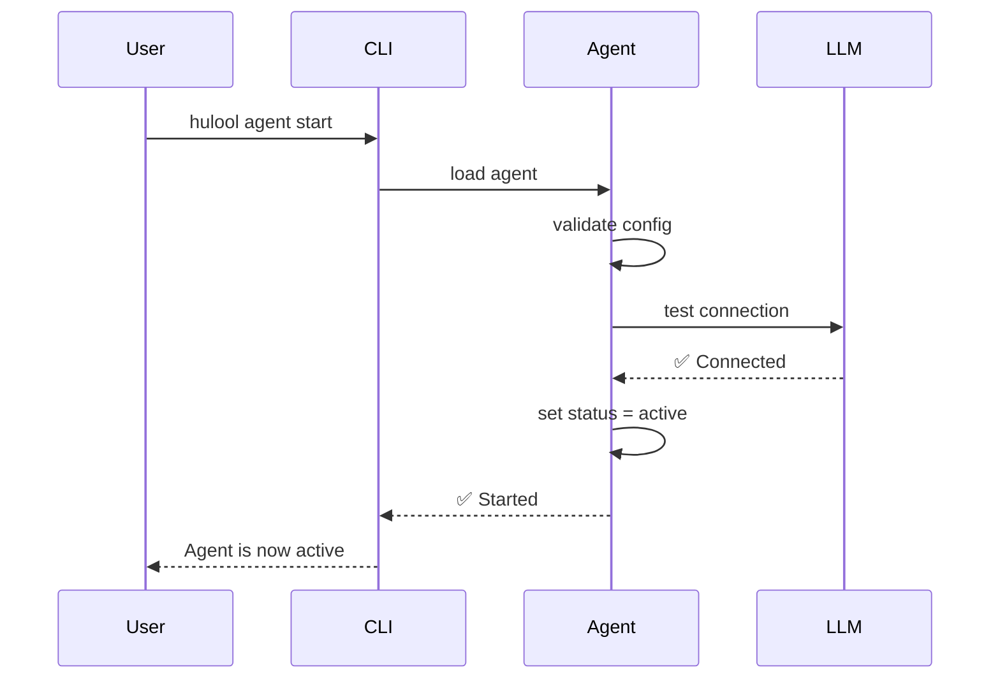
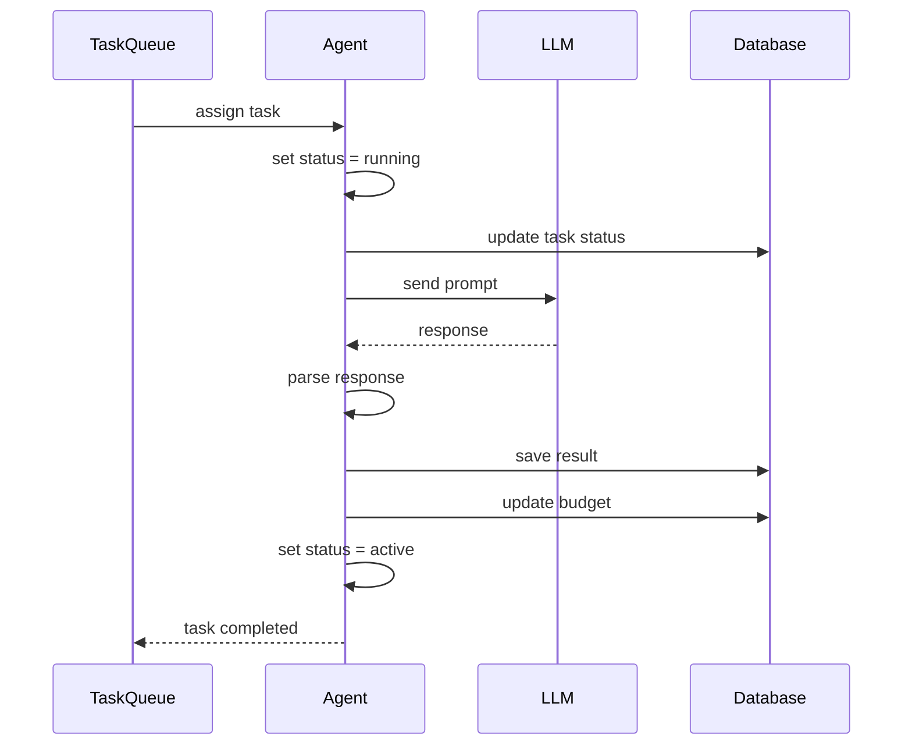
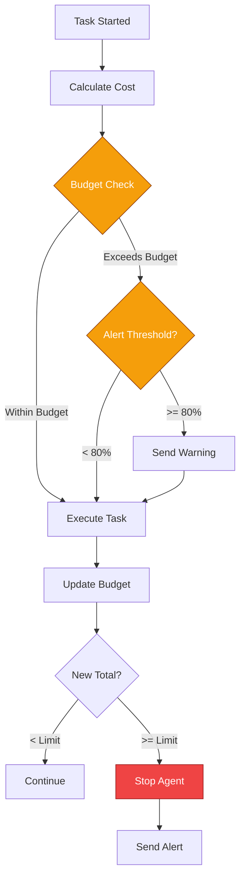
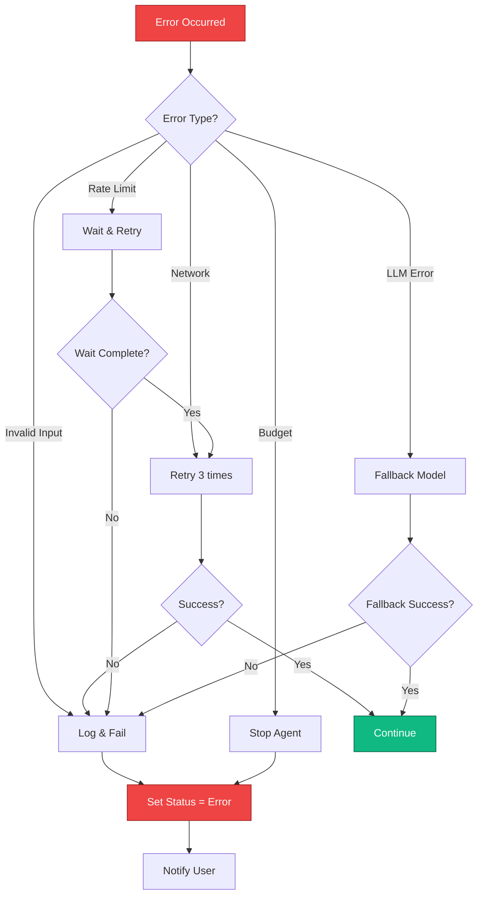
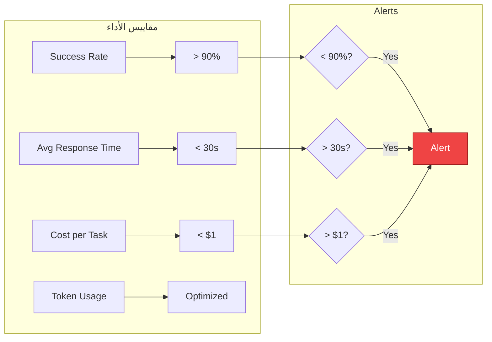
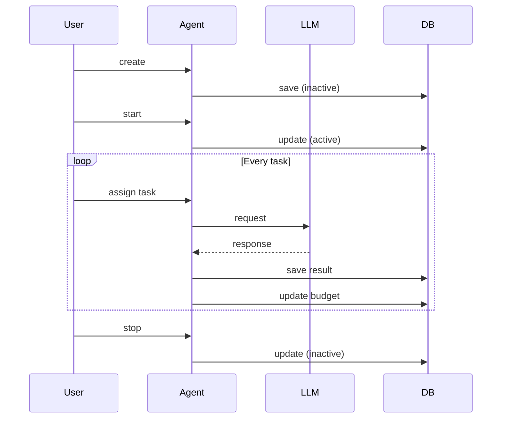
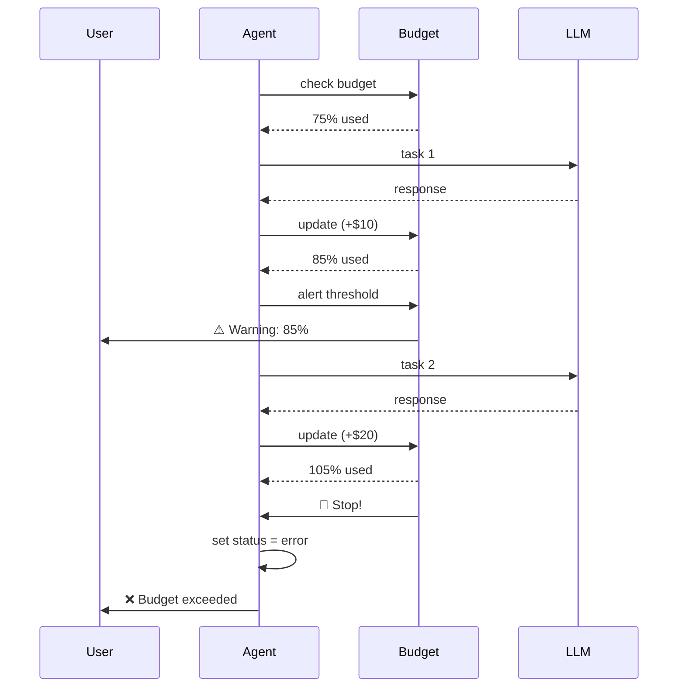

# 🤖 Agent Lifecycle - Hulool OS

## نظرة عامة

دورة حياة الوكيل في Hulool OS من الإنشاء حتى التقاعد.

---

## 🔄 دورة الحياة الكاملة



---

## 📊 حالات الوكيل



---

## 🎯 transitions (الانتقالات)

### 1. Created → Inactive



### 2. Inactive → Active



### 3. Active → Running



---

## 💰 إدارة الميزانية



### مستويات التنبيه

| المستوى | العتبة | الإجراء |
|---------|--------|---------|
| 🟢 **آمن** | < 50% | لا شيء |
| 🟡 **تحذير** | 50-80% | إشعار في الـ Dashboard |
| 🟠 **تنبيه** | 80-95% | إشعار + Email |
| 🔴 **حرج** | > 95% | إيقاف الوكيل تلقائياً |

---

## 🔄 معالجة الأخطاء



---

## 📈 مراقبة الأداء



---

## 🎯 أوامر دورة الحياة

```bash
# الإنشاء
hulool agent create

# البدء
hulool agent start <id>

# الإيقاف
hulool agent stop <id>

# الإيقاف المؤقت
hulool agent pause <id>

# الاستئناف
hulool agent resume <id>

# إعادة التشغيل
hulool agent restart <id>

# الحذف
hulool agent delete <id>

# العرض
hulool agent list
hulool agent info <id>
```

---

## 📊 أمثلة على سيناريوهات دورة الحياة

### السيناريو 1: وكيل بحث يعمل بشكل طبيعي



### السيناريو 2: وكيل يتجاوز الميزانية



---

## 🎓 أفضل الممارسات

### ✅ افعل

1. **ابدأ بميزانية صغيرة**: اختبر الوكيل قبل زيادة الميزانية
2. **راقب الأداء**: استخدم `hulool monitor` بانتظام
3. **استخدم النماذج المناسبة**: GPT-3.5 للمهام البسيطة، GPT-4 للمعقدة
4. **حدد timeouts**: تجنب المهام اللانهائية
5. **سجل الأخطاء**: حلل الأنماط المتكررة

### ❌ لا تفعل

1. **لا تترك الوكلاء بدون مراقبة**: قد يستهلكون الميزانية بسرعة
2. **لا تستخدم GPT-4 لكل شيء**: مكلف وغير ضروري
3. **لا تتجاهل التنبيهات**: قد تشير لمشاكل حقيقية
4. **لا تنشئ وكلاء متشابهين**: وفر الموارد

---

## 📚 مراجع

- [Agent Design Patterns](https://www.patterns.ai/agents)
- [LLM Best Practices](https://docs.anthropic.com/claude/docs/best-practices)
- [Budget Management](https://hulool.ai/docs/budget)
