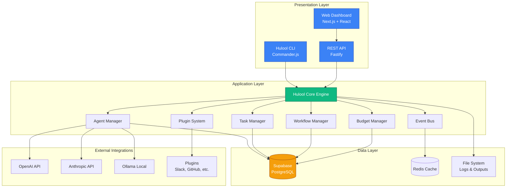
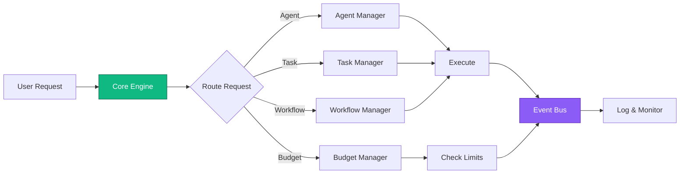
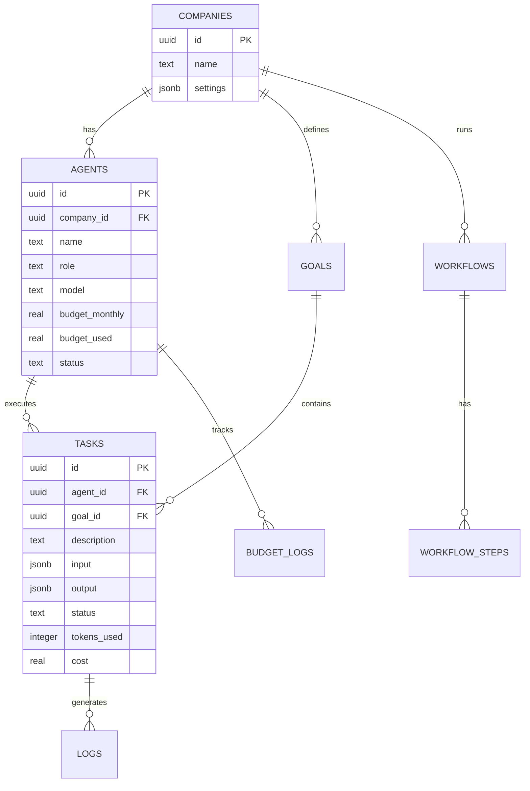
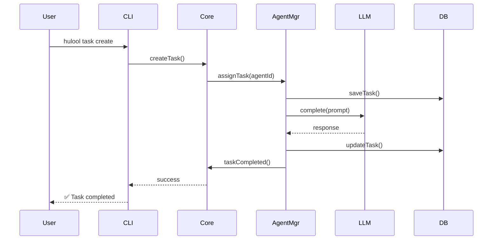
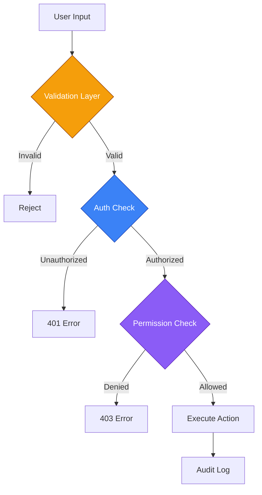

# 🏗️ Architecture - Hulool OS

## نظرة عامة على المعمارية

يعتمد Hulool OS على **معمارية الطبقات (Layered Architecture)** مع فصل واضح للمسؤوليات، مما يضمن قابلية التوسع والصيانة.



---

## 📦 مكونات النظام

### 1. Presentation Layer (طبقة العرض)

| المكون | الوصف | التقنيات |
|--------|-------|----------|
| **Hulool CLI** | واجهة سطر الأوامر للمطورين | Commander.js, Inquirer, Chalk |
| **Web Dashboard** | لوحة تحكم رسومية | Next.js 14, React, Tailwind |
| **REST API** | واجهة برمجية للتكامل | Fastify, TypeScript |

### 2. Application Layer (طبقة التطبيقات)



### 3. Data Layer (طبقة البيانات)



---

## 🔄 أنماط التصميم المستخدمة

### 1. Command Pattern (CLI)
```typescript
// كل أمر CLI هو كائن مستقل
class InitCommand extends Command {
  async execute() { /* ... */ }
}
```

### 2. Observer Pattern (Event Bus)
```typescript
// الأحداث تُرسل للمستلمين
eventBus.emit('agent:completed', { agentId, taskId });
eventBus.on('agent:completed', handler);
```

### 3. Strategy Pattern (LLM Providers)
```typescript
// تبديل مزودي LLM بسهولة
interface LLMProvider {
  complete(prompt: string): Promise<string>;
}

class OpenAIProvider implements LLMProvider { }
class AnthropicProvider implements LLMProvider { }
```

### 4. Repository Pattern (Data Access)
```typescript
// فصل منطق البيانات
class AgentRepository {
  async findById(id: string): Promise<Agent> { }
  async save(agent: Agent): Promise<void> { }
}
```

---

## 🌐 تدفق البيانات



---

## 🔒 الأمان



### طبقات الأمان:
1. **Input Validation**: Zod schemas
2. **Authentication**: Supabase Auth
3. **Authorization**: Role-based access
4. **Rate Limiting**: Per-agent budgets
5. **Audit Logging**: All actions tracked

---

## 📊 قابلية التوسع

### Horizontal Scaling
- Stateless API servers
- Redis for session management
- Supabase for data persistence

### Vertical Scaling
- Worker threads for CPU-intensive tasks
- Connection pooling for database
- Caching with Redis

---

## 🎯 قرارات معمارية مهمة

| القرار | البديل | السبب |
|--------|--------|-------|
| **TypeScript** | JavaScript | أمان الأنواع، صيانة أسهل |
| **Fastify** | Express | أداء أعلى، TypeScript-first |
| **Supabase** | Firebase | PostgreSQL أقوى، مفتوح المصدر |
| **Drizzle ORM** | Prisma | أخف، أسرع، TypeScript-native |
| **pnpm** | npm | أسرع، يوفر المساحة |
| **Mermaid** | Draw.io | نصي، يعمل مع Git |

---

## 📚 مراجع

- [Node.js Best Practices](https://github.com/goldbergyoni/nodebestpractices)
- [TypeScript Deep Dive](https://basarat.gitbook.io/typescript/)
- [Supabase Documentation](https://supabase.com/docs)
- [Fastify Documentation](https://www.fastify.io/docs)
