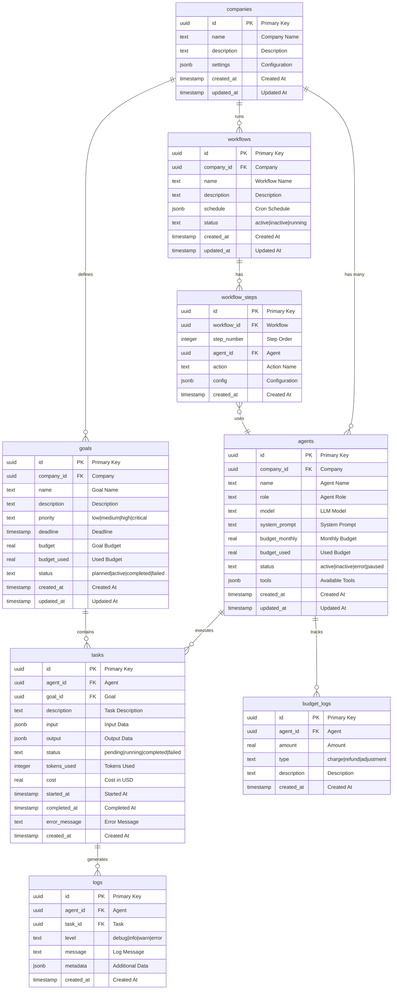

# 🗄️ Database Schema - Hulool OS

## نظرة عامة

يستخدم Hulool OS **Supabase** (PostgreSQL) كقاعدة بيانات رئيسية، مع **Drizzle ORM** للوصول إلى البيانات.

---

## 📊 مخطط قاعدة البيانات الكامل



---

## 📋 تعريف الجداول

### 1. جدول الشركات (companies)

```sql
CREATE TABLE companies (
  id UUID PRIMARY KEY DEFAULT gen_random_uuid(),
  name TEXT NOT NULL,
  description TEXT,
  settings JSONB DEFAULT '{}',
  created_at TIMESTAMP WITH TIME ZONE DEFAULT NOW(),
  updated_at TIMESTAMP WITH TIME ZONE DEFAULT NOW()
);
```

### 2. جدول الوكلاء (agents)

```sql
CREATE TABLE agents (
  id UUID PRIMARY KEY DEFAULT gen_random_uuid(),
  company_id UUID NOT NULL REFERENCES companies(id) ON DELETE CASCADE,
  name TEXT NOT NULL,
  role TEXT NOT NULL,
  model TEXT NOT NULL DEFAULT 'gpt-4',
  system_prompt TEXT,
  budget_monthly REAL NOT NULL DEFAULT 100,
  budget_used REAL NOT NULL DEFAULT 0,
  status TEXT NOT NULL DEFAULT 'inactive' 
    CHECK (status IN ('active', 'inactive', 'error', 'paused')),
  tools JSONB DEFAULT '[]',
  created_at TIMESTAMP WITH TIME ZONE DEFAULT NOW(),
  updated_at TIMESTAMP WITH TIME ZONE DEFAULT NOW()
);

CREATE INDEX idx_agents_company ON agents(company_id);
CREATE INDEX idx_agents_status ON agents(status);
```

### 3. جدول الأهداف (goals)

```sql
CREATE TABLE goals (
  id UUID PRIMARY KEY DEFAULT gen_random_uuid(),
  company_id UUID NOT NULL REFERENCES companies(id) ON DELETE CASCADE,
  name TEXT NOT NULL,
  description TEXT,
  priority TEXT NOT NULL DEFAULT 'medium'
    CHECK (priority IN ('low', 'medium', 'high', 'critical')),
  deadline TIMESTAMP WITH TIME ZONE,
  budget REAL NOT NULL DEFAULT 0,
  budget_used REAL NOT NULL DEFAULT 0,
  status TEXT NOT NULL DEFAULT 'planned'
    CHECK (status IN ('planned', 'active', 'completed', 'failed')),
  created_at TIMESTAMP WITH TIME ZONE DEFAULT NOW(),
  updated_at TIMESTAMP WITH TIME ZONE DEFAULT NOW()
);

CREATE INDEX idx_goals_company ON goals(company_id);
CREATE INDEX idx_goals_status ON goals(status);
```

### 4. جدول المهام (tasks)

```sql
CREATE TABLE tasks (
  id UUID PRIMARY KEY DEFAULT gen_random_uuid(),
  agent_id UUID NOT NULL REFERENCES agents(id) ON DELETE CASCADE,
  goal_id UUID REFERENCES goals(id) ON DELETE SET NULL,
  description TEXT NOT NULL,
  input JSONB DEFAULT '{}',
  output JSONB DEFAULT '{}',
  status TEXT NOT NULL DEFAULT 'pending'
    CHECK (status IN ('pending', 'running', 'completed', 'failed', 'cancelled')),
  tokens_used INTEGER NOT NULL DEFAULT 0,
  cost REAL NOT NULL DEFAULT 0,
  started_at TIMESTAMP WITH TIME ZONE,
  completed_at TIMESTAMP WITH TIME ZONE,
  error_message TEXT,
  created_at TIMESTAMP WITH TIME ZONE DEFAULT NOW()
);

CREATE INDEX idx_tasks_agent ON tasks(agent_id);
CREATE INDEX idx_tasks_goal ON tasks(goal_id);
CREATE INDEX idx_tasks_status ON tasks(status);
CREATE INDEX idx_tasks_created ON tasks(created_at);
```

---

## 🔍 الاستعلامات الشائعة

### عرض الوكلاء النشطين مع ميزانياتهم

```typescript
const activeAgents = await db
  .select()
  .from(agents)
  .where(eq(agents.status, 'active'));
```

### حساب التكلفة الإجمالية لهذا الشهر

```typescript
const monthlyCost = await db
  .select({
    total: sql`SUM(${tasks.cost})`
  })
  .from(tasks)
  .where(sql`DATE_TRUNC('month', ${tasks.created_at}) = DATE_TRUNC('month', NOW())`);
```

### عرض المهام الفاشلة مع تفاصيل الوكلاء

```typescript
const failedTasks = await db
  .select({
    task: tasks,
    agent: agents
  })
  .from(tasks)
  .innerJoin(agents, eq(tasks.agentId, agents.id))
  .where(eq(tasks.status, 'failed'));
```

---

## 📈 تحسينات الأداء

### Indexes

```sql
-- Indexes for common queries
CREATE INDEX idx_tasks_agent_status ON tasks(agent_id, status);
CREATE INDEX idx_tasks_created_desc ON tasks(created_at DESC);
CREATE INDEX idx_logs_agent_created ON logs(agent_id, created_at DESC);
CREATE INDEX idx_budget_logs_agent ON budget_logs(agent_id, created_at DESC);
```

### Partitioning (للجداول الكبيرة)

```sql
-- تقسيم جدول logs حسب الشهر
CREATE TABLE logs (
  -- ... columns
) PARTITION BY RANGE (created_at);

CREATE TABLE logs_2026_01 PARTITION OF logs
  FOR VALUES FROM ('2026-01-01') TO ('2026-02-01');
```

---

## 🔐 الأمان

### Row Level Security (RLS)

```sql
-- تفعيل RLS
ALTER TABLE agents ENABLE ROW LEVEL SECURITY;

-- سياسة: المستخدمون يرون وكلاء شركتهم فقط
CREATE POLICY "Users can view their company's agents"
  ON agents
  FOR SELECT
  USING (company_id = current_setting('app.current_company_id')::uuid);
```

### Encryption

```typescript
// تشفير البيانات الحساسة
import { encrypt, decrypt } from './crypto';

const encryptedKey = encrypt(process.env.OPENAI_API_KEY!);
const decryptedKey = decrypt(encryptedKey);
```

---

## 📊 Drizzle Schema (TypeScript)

```typescript
import { pgTable, uuid, text, real, integer, timestamp, jsonb } from 'drizzle-orm/pg-core';

export const agents = pgTable('agents', {
  id: uuid('id').defaultRandom().primaryKey(),
  companyId: uuid('company_id').notNull(),
  name: text('name').notNull(),
  role: text('role').notNull(),
  model: text('model').default('gpt-4').notNull(),
  systemPrompt: text('system_prompt'),
  budgetMonthly: real('budget_monthly').default(100).notNull(),
  budgetUsed: real('budget_used').default(0).notNull(),
  status: text('status').default('inactive').notNull(),
  tools: jsonb('tools').default([]),
  createdAt: timestamp('created_at').defaultNow().notNull(),
  updatedAt: timestamp('updated_at').defaultNow().notNull(),
});
```

---

## 🚀 Migration Commands

```bash
# إنشاء migration جديد
pnpm db:generate

# تطبيق migrations على Supabase
pnpm db:push

# فتح Drizzle Studio
pnpm db:studio

# إعادة تعيين قاعدة البيانات
pnpm db:reset
```

---

## 📚 مراجع

- [Supabase Documentation](https://supabase.com/docs)
- [Drizzle ORM](https://orm.drizzle.team)
- [PostgreSQL Documentation](https://www.postgresql.org/docs)
