# 👤 User Journey - Hulool OS

## نظرة عامة

رحلة المستخدم في Hulool OS من البداية حتى النجاح.

---

## 🎯 personas (الشخصيات)

### 1. أحمد - رائد الأعمال الفردي

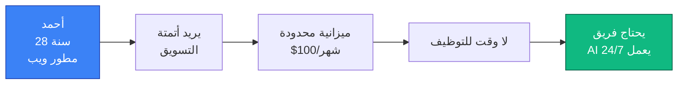

**الأهداف**:
- أتمتة إنشاء المحتوى
- تقليل التكاليف
- التوسع دون توظيف

**التحديات**:
- وقت محدود
- ميزانية ضيقة
- لا يريد تعلم أدوات معقدة

---

## 🗺️ خريطة رحلة المستخدم

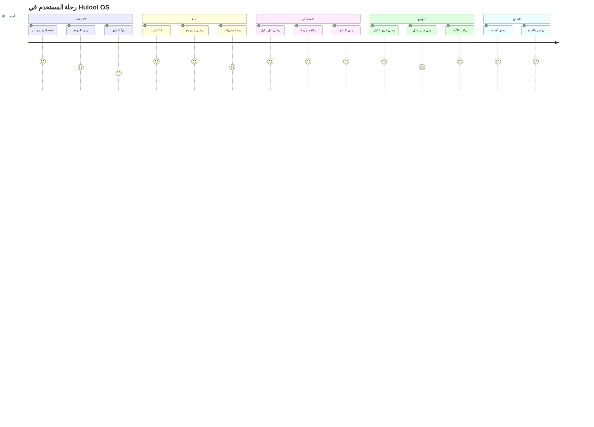

---

## 📊 تدفق المستخدم التفصيلي

### المرحلة 1: الاكتشاف

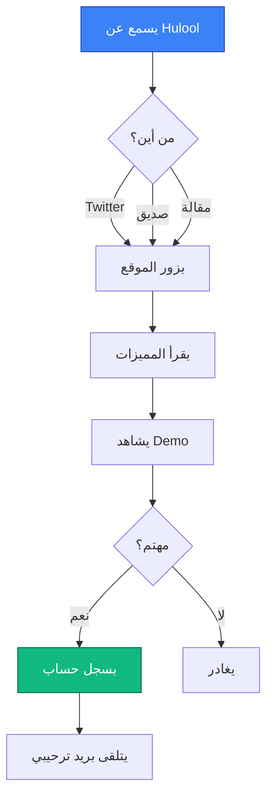

### المرحلة 2: الإعداد الأولي

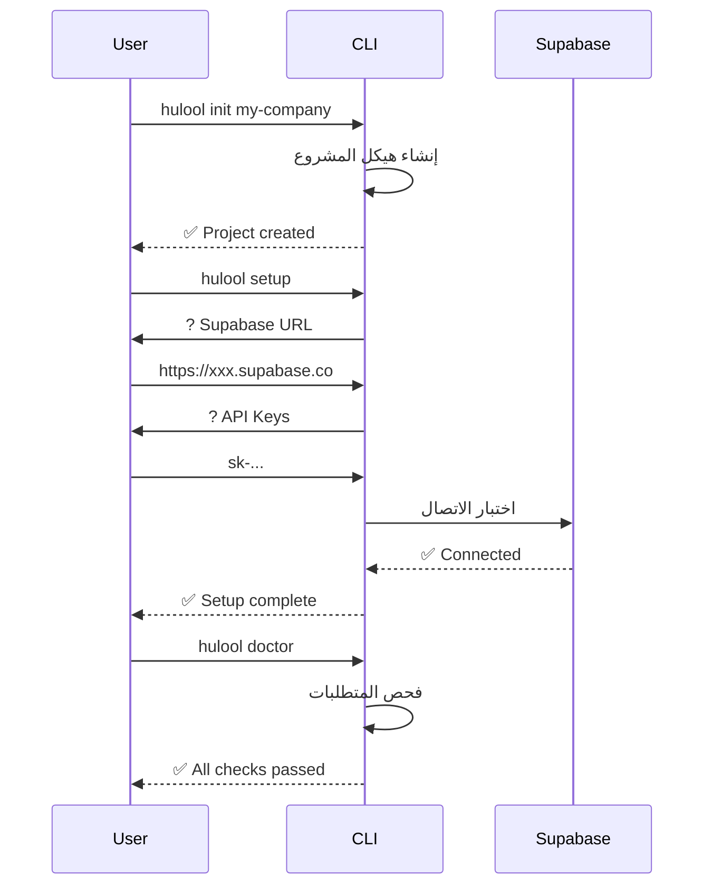

### المرحلة 3: إنشاء أول وكيل

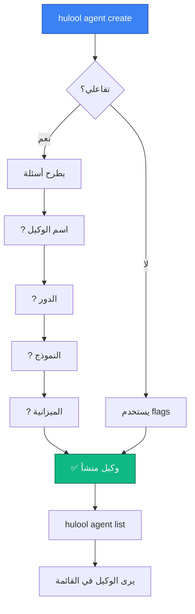

### المرحلة 4: تكليف الوكيل بمهمة

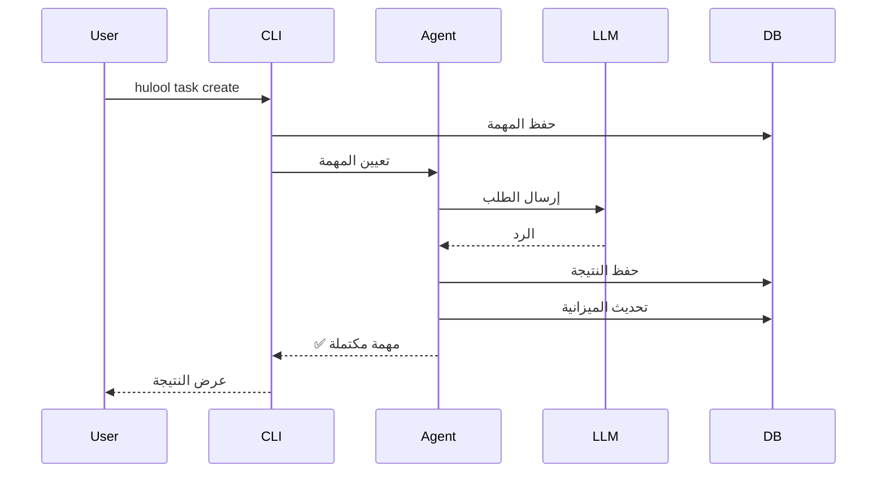

### المرحلة 5: المراقبة والتحسين

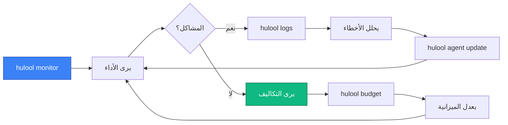

---

## 🎯 نقاط الألم والحلول

### نقطة الألم 1: التعقيد

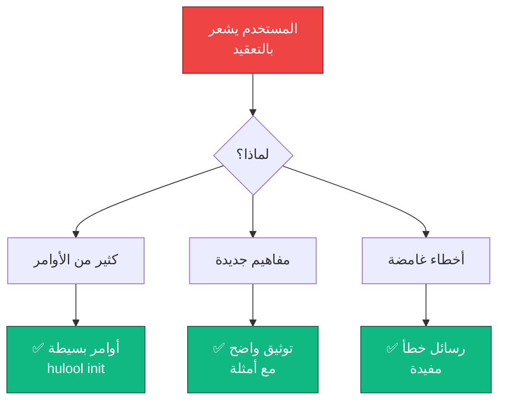

### نقطة الألم 2: التكاليف

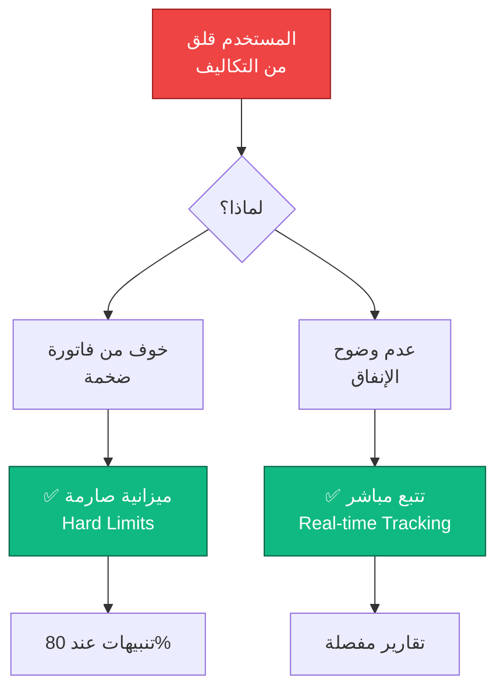

---

## 📈 مقاييس النجاح

### Time-to-First-Value (TTFV)

```mermaid
gantt
    title الوقت حتى أول قيمة
    dateFormat X
    axisFormat %s ثانية
    
    section الإعداد
    تثبيت CLI           :0, 30
    إنشاء مشروع          :30, 60
    إعداد API Keys       :60, 120
    
    section الاستخدام
    إنشاء وكيل           :120, 180
    تكليف بمهمة          :180, 240
    رؤية النتيجة         :240, 300
```

**الهدف**: أقل من 5 دقائق من التثبيت حتى أول نتيجة

### User Satisfaction

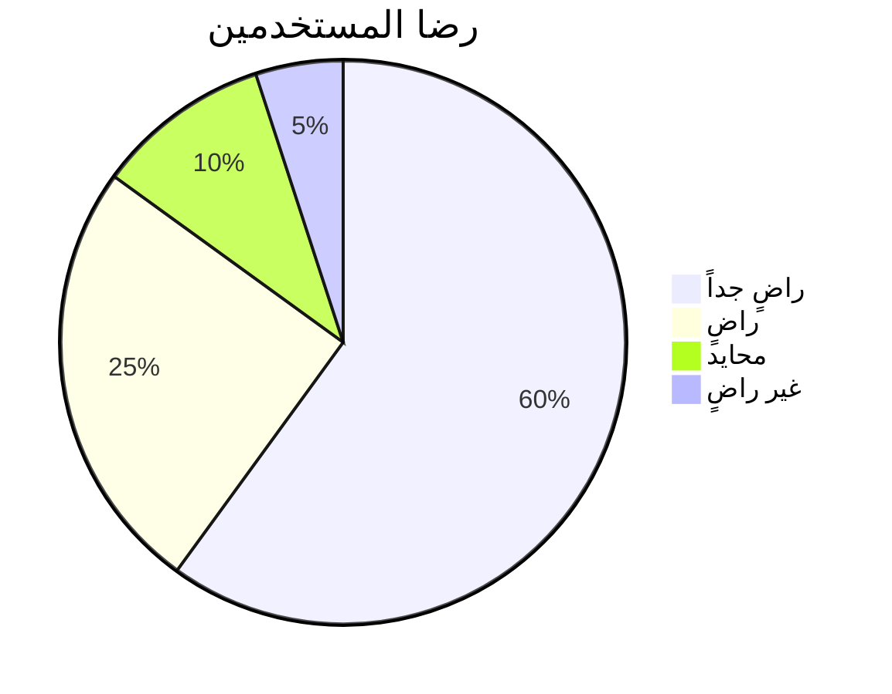

---

## 🎓 رحلة التعلم

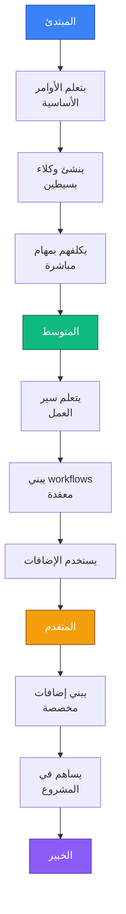

---

## 📚 مراجع

- [Nielsen Norman Group - User Journey Maps](https://www.nngroup.com/articles/journey-mapping-101/)
- [Interaction Design Foundation - User Personas](https://www.interaction-design.org/literature/topics/user-personas)
