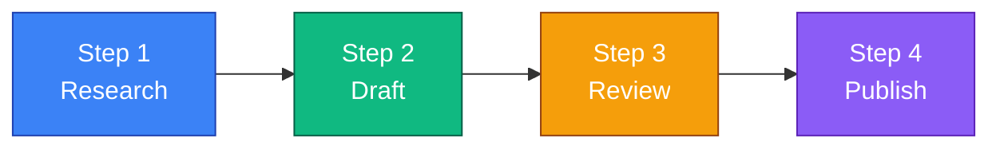
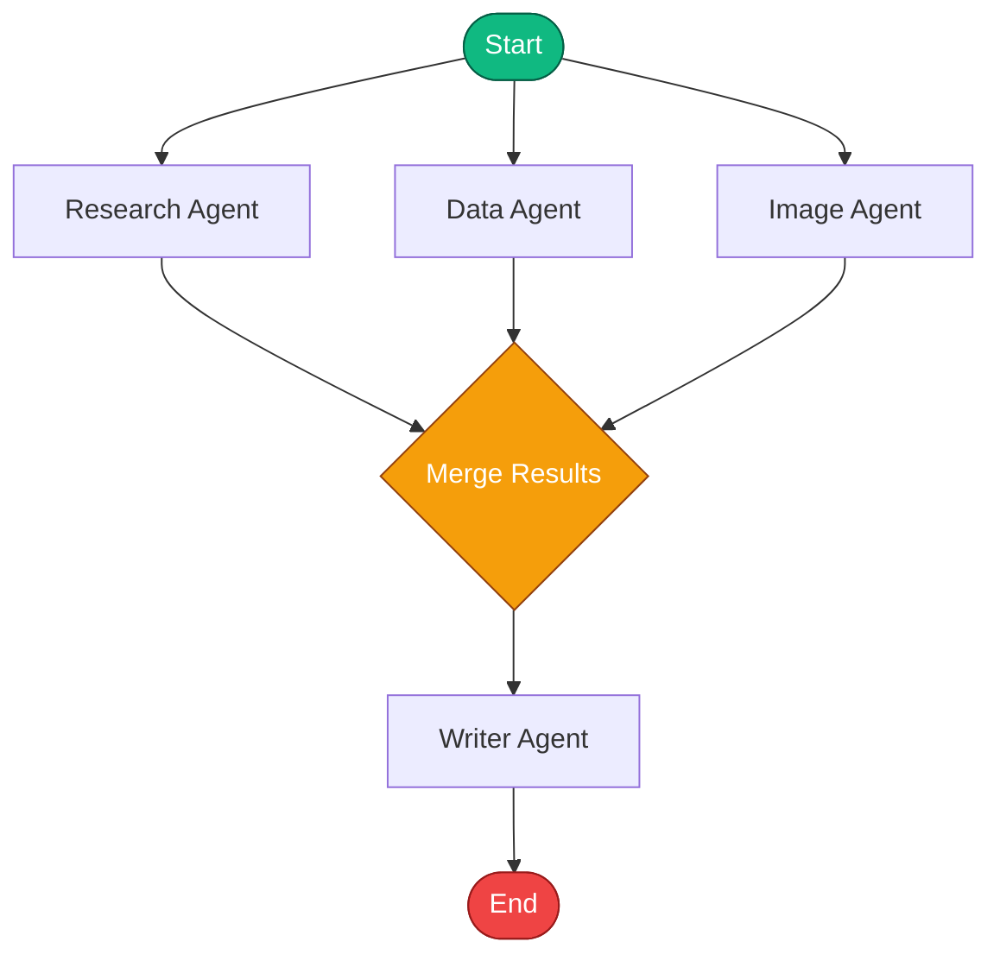
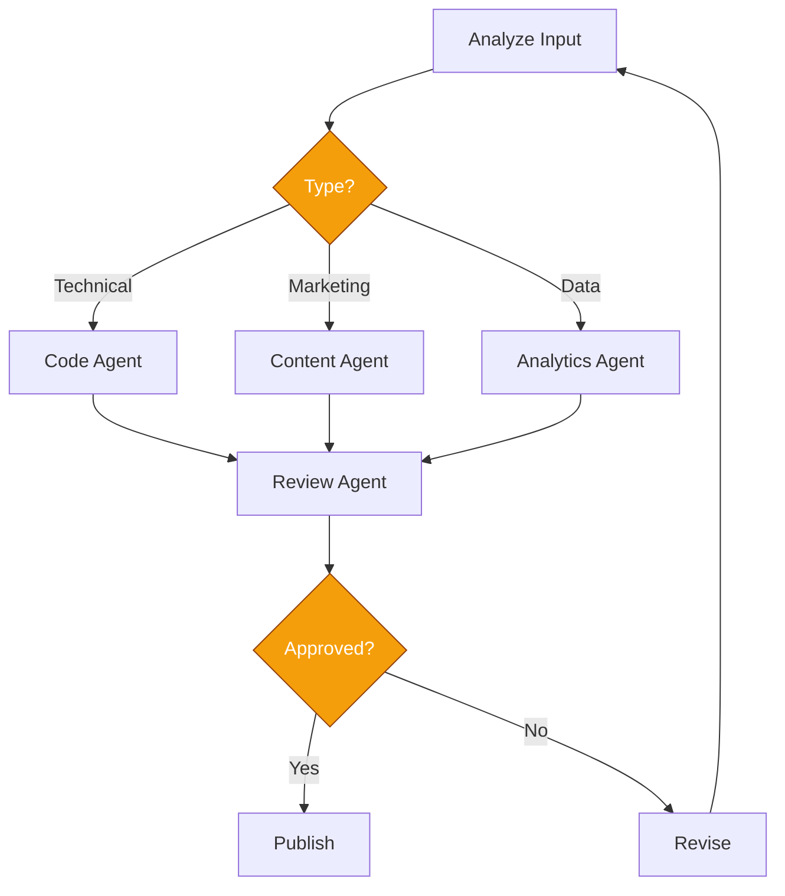
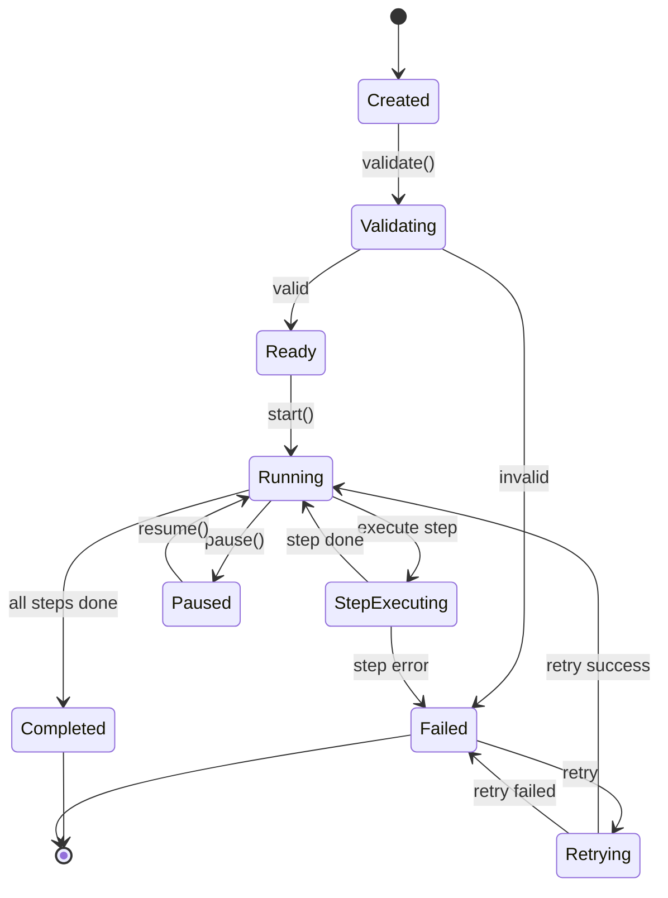
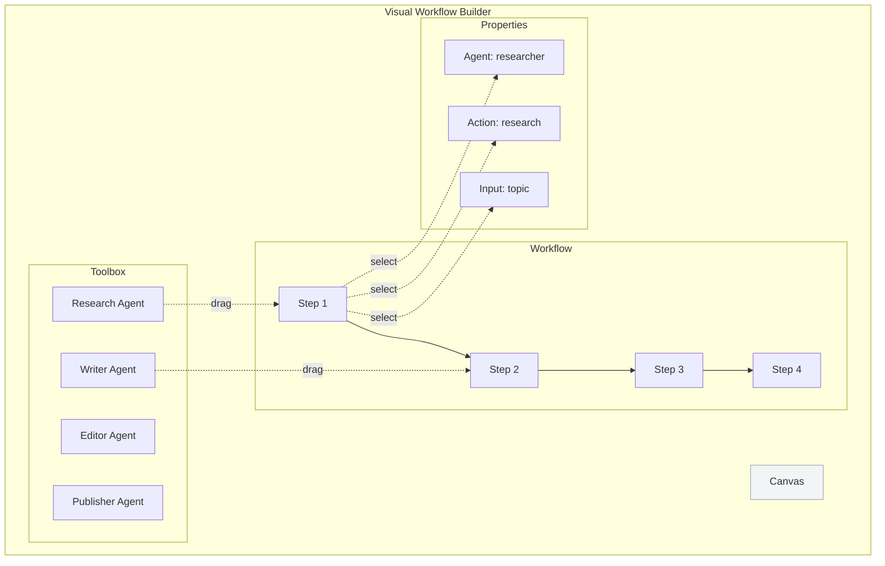
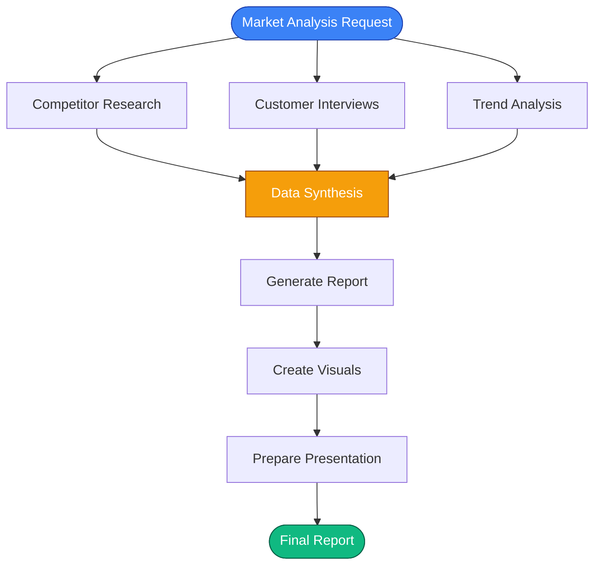

# 🔄 Workflows - Hulool OS

## نظرة عامة

سير العمل (Workflows) في Hulool OS هو تسلسل منظم من الخطوات التي تنفذها وكلاء الذكاء الاصطناعي لتحقيق هدف معين.

---

## 🎯 أنواع سير العمل

### 1. Sequential Workflow (تسلسلي)



**مثال**: إنشاء مقال مدونة
1. **Research Agent**: جمع المعلومات
2. **Writer Agent**: كتابة المسودة
3. **Editor Agent**: المراجعة والتحرير
4. **Publisher Agent**: النشر

### 2. Parallel Workflow (متوازي)



**مثال**: تقرير شامل
- 3 وكلاء يعملون بالتوازي
- دمج النتائج في النهاية

### 3. Conditional Workflow (شرطي)



---

## 🏗️ بنية سير العمل

### ملف تعريف سير العمل

```json
{
  "id": "content-pipeline",
  "name": "Content Creation Pipeline",
  "description": "End-to-end content creation workflow",
  "steps": [
    {
      "id": "step-1",
      "agent": "researcher",
      "action": "research_topic",
      "input": {
        "topic": "{{input.topic}}",
        "depth": "comprehensive"
      },
      "output_mapping": {
        "research_data": "step-2.research"
      }
    },
    {
      "id": "step-2",
      "agent": "writer",
      "action": "write_draft",
      "input": {
        "research": "{{step-1.research_data}}",
        "tone": "professional"
      }
    }
  ],
  "error_handling": {
    "retry_attempts": 3,
    "fallback_agent": "backup-writer"
  }
}
```

---

## 🔄 دورة حياة سير العمل



---

## 🎨 محرر سير العمل البصري



---

## 📊 أمثلة عملية

### مثال 1: خط إنتاج المحتوى


**التكلفة المتوقعة**: ~$0.50  
**الوكلاء**: 5  
**النماذج**: GPT-4 + Claude 3

### مثال 2: تحليل السوق



---

## 🔧 أوامر CLI لسير العمل

```bash
# إنشاء سير عمل جديد
hulool workflow create

# تشغيل سير عمل
hulool workflow run content-pipeline --input '{"topic": "AI Trends"}'

# جدولة سير عمل
hulool workflow schedule content-pipeline --cron "0 9 * * 1"

# عرض حالة سير العمل
hulool workflow status content-pipeline

# إلغاء سير عمل
hulool workflow cancel <run-id>

# عرض سجل التشغيل
hulool workflow logs <run-id>
```

---

## 🎯 أفضل الممارسات

### ✅ افعل

1. **ابدأ بسيطاً**: سير عمل من 3-5 خطوات
2. **اختبر كل خطوة**: تأكد من عمل كل وكيل منفرداً
3. **حدد timeouts**: تجنب الحلقات اللانهائية
4. **استخدم error handling**: تعامل مع الفشل بذكاء
5. **راقب التكاليف**: حدد ميزانية لكل سير عمل

### ❌ لا تفعل

1. **لا تنشئ سير عمل طويلاً جداً**: قسمه لسير عمل أصغر
2. **لا تعتمد على وكيل واحد**: استخدم fallback agents
3. **لا تتجاهل الأخطاء**: سجلها وحللها
4. **لا تستخدم نماذج باهظة للمهام البسيطة**

---

## 📚 مراجع

- [Workflow Patterns](https://workflowpatterns.com)
- [BPMN 2.0 Specification](https://www.omg.org/spec/BPMN/)
- [Temporal.io Documentation](https://docs.temporal.io)
